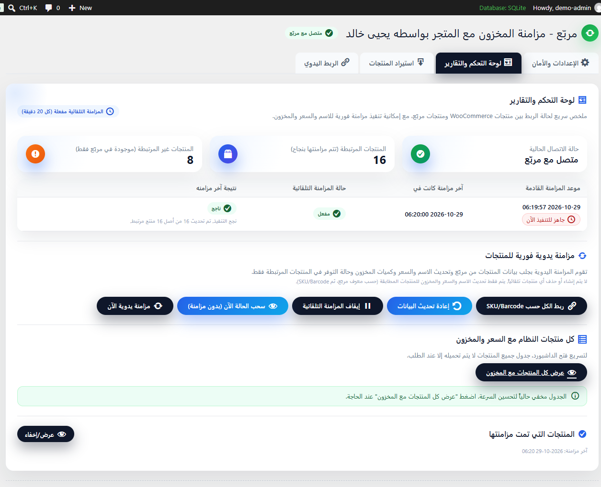
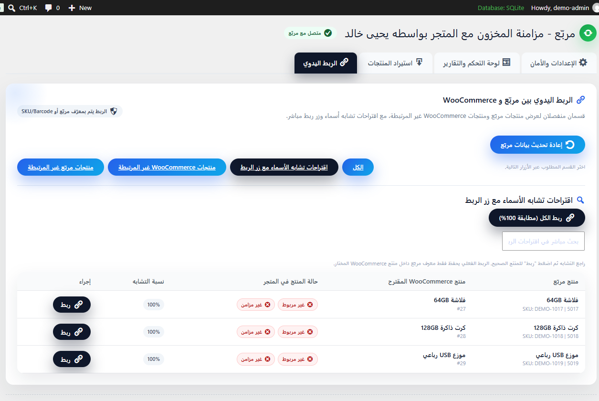
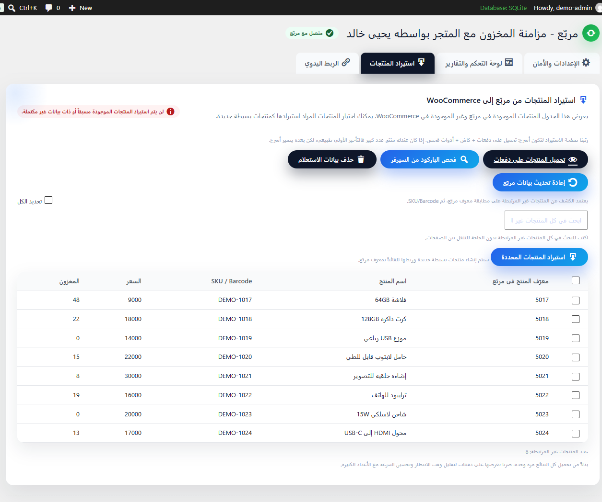
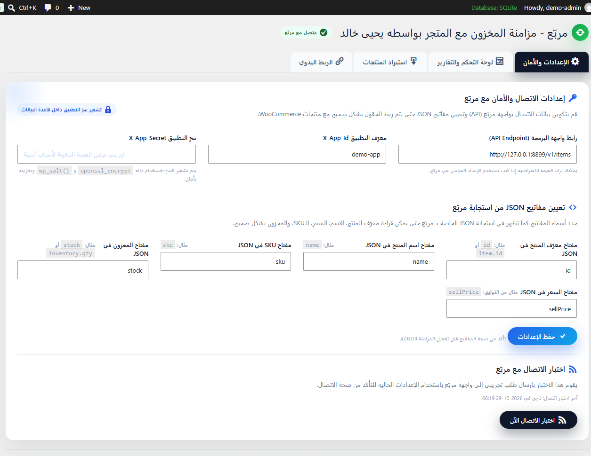
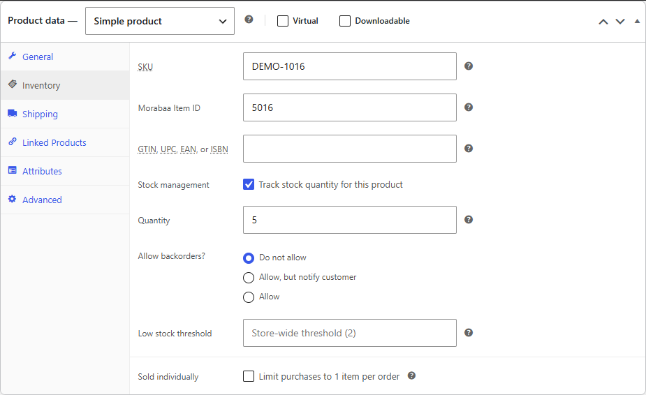

# Morabaa WooCommerce Inventory Sync

إضافة WordPress تربط متجر WooCommerce بنظام نقاط البيع **مربّع (Morabaa POS)**، فيبقى مخزون المتجر وأسعاره مطابقة لما في نقطة البيع، بدون إدخال يدوي.

A WordPress plugin that keeps WooCommerce stock and prices in sync with **Morabaa POS** through its API, with a full Arabic admin dashboard.

> [!IMPORTANT]
> **إضافة مستقلة.** هذه الإضافة ليست تابعة لشركة مربّع، ولا صادرة عنها، ولا معتمدة منها، ولا مرتبطة بها بأي شكل. «مربّع» و«Morabaa» علامتان تجاريتان لأصحابهما، وذكرهما هنا فقط لتوضيح التوافق. الدعم والمسؤولية عن الإضافة على مطوّرها وحده.
>
> **Independent project.** This plugin is not affiliated with, endorsed by, sponsored by or connected to Morabaa in any way. "Morabaa" is a trademark of its respective owner and is used here only to describe compatibility.

## ليش هذه الإضافة؟

المحل اللي يبيع من نقطة بيع وأونلاين بنفس الوقت يواجه نفس المشكلة دائماً: المنتج ينفد بالمحل ويبقى ظاهراً بالموقع، أو العكس. الإضافة تسحب الكميات والأسعار من مربّع كل 20 دقيقة وتحدّث WooCommerce تلقائياً، وتربط كل منتج بالمادة المقابلة له.

## الميزات

| | |
|---|---|
| **مزامنة تلقائية** | كل 20 دقيقة عبر WP-Cron، مع زر مزامنة يدوية فورية وزر سحب الحالة بدون مزامنة. |
| **ربط ذكي للمنتجات** | بالـ Item ID من مربّع، أو بالـ SKU والباركود (حتى لو رجع الباركود كقائمة)، أو باقتراحات تشابه الأسماء مع نسبة التطابق. |
| **ربط جماعي** | ربط كل المطابقات الدقيقة بضغطة واحدة. |
| **استيراد** | استيراد مواد مربّع غير الموجودة في المتجر كمنتجات جديدة، مع بحث واختيار. |
| **تخصيص الحقول** | تحدد أي مفتاح في استجابة الـ API يمثل المعرّف والاسم والسعر والمخزون والـ SKU. |
| **لوحة تحكم عربية** | حالة الاتصال، المنتجات المربوطة وغير المربوطة، آخر مزامنة، وأداة تشخيص للباركود. |
| **أمان** | الـ App Secret يُشفَّر في قاعدة البيانات (OpenSSL مع مفاتيح WordPress)، والإضافة **تقرأ فقط** من مربّع (طلبات GET). |

## لقطات الشاشة

> اللقطات من موقع تجريبي محلي ببيانات وهمية.

| الربط واقتراحات الأسماء | الاستيراد |
|---|---|
|  |  |

| الإعدادات والأمان | حقل Morabaa Item ID داخل المنتج |
|---|---|
|  |  |

## المتطلبات

- WordPress مع WooCommerce مفعّل.
- حساب مربّع وبيانات الربط: **App ID** و**App Secret**.
- PHP مع إضافة OpenSSL.

## التثبيت

1. حمّل أحدث نسخة: `Code` ← `Download ZIP`.
2. من لوحة WordPress: **الإضافات** ← **أضف جديد** ← **رفع إضافة**، واختر الملف.
3. فعّل الإضافة، فتظهر قائمة **مزامنة مع المربّع** في لوحة التحكم.

## الإعداد

1. افتح **الإعدادات والأمان** وأدخل **App ID** و**App Secret**.
2. اترك عنوان الـ API على القيمة الافتراضية `https://api.mymorabaa.com/v1/items` إلا إذا عندك عنوان مختلف.
3. اضغط **حفظ الإعدادات**، ثم **اختبار الاتصال الآن**.
4. من **الربط اليدوي** ابدأ بـ «ربط الكل حسب SKU/Barcode»، ثم راجع اقتراحات الأسماء للمنتجات المتبقية.
5. من **لوحة التحكم والتقارير** تأكد أن المزامنة التلقائية مفعّلة.

## ملاحظات

- WP-Cron يعتمد على زيارات الموقع. إذا كان الموقع قليل الزيارات، اربط `wp-cron.php` بـ cron حقيقي على السيرفر حتى تبقى المزامنة منتظمة.
- الإضافة لا تكتب أي شيء في مربّع، والتحديث يصير على جهة WooCommerce فقط.

## English summary

- Syncs WooCommerce stock and sell price from Morabaa POS every 20 minutes (WP-Cron), plus manual sync.
- Links products by Morabaa item ID, SKU/barcode, or name-similarity suggestions; bulk linking and importing.
- Configurable JSON field mapping, Arabic RTL admin UI, App Secret encrypted at rest, read-only API access.

## الرخصة

[GPL-2.0-or-later](LICENSE): تقدر تستخدم الإضافة وتعدّلها وتوزّعها، بشرط أن تبقى أي نسخة معدّلة تحت نفس الرخصة.

Licensed under the GNU General Public License v2.0 or later.

## المطوّر

**[Yahya Khalid](https://github.com/yahyakhalid)** · [akkadX](https://akkadx.com) · [hi@akkadx.com](mailto:hi@akkadx.com)
